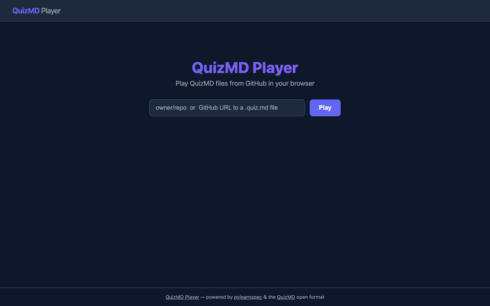
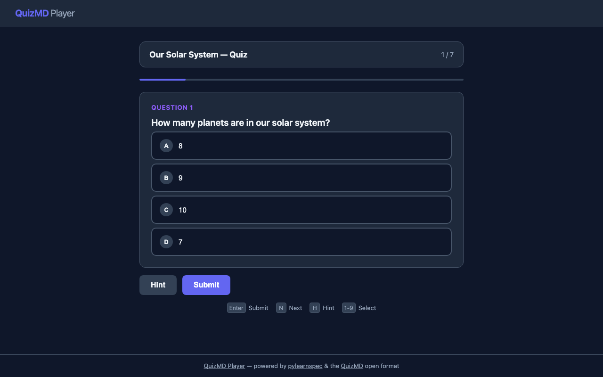
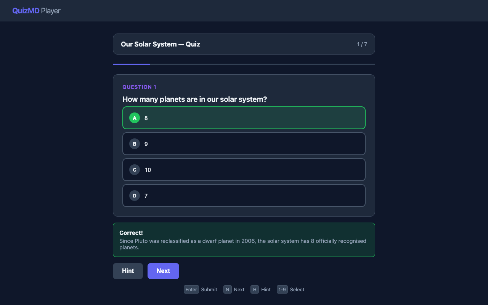
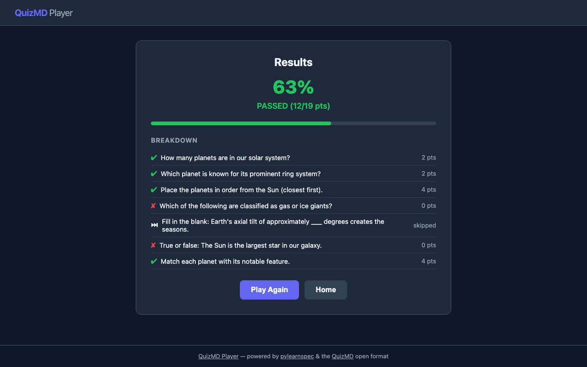

# QuizMD Web Client

A simple, open-source web player for [QuizMD](https://quizmd.org) files. Load quizzes from GitHub and play them in your browser.

Built with [pylearnspec](https://github.com/learnspec/pylearnspec) and Flask.

## Screenshots

### Welcome screen
Enter a GitHub `owner/repo` or a direct URL to a `.quiz.md` file:



### Playing a quiz
Answer multiple-choice, multi-select, true/false, open-answer, match, and ordering questions:



### Instant feedback
See correct/incorrect feedback with explanations after each answer:



### Results
Get a full breakdown with score, pass/fail status, and per-question results:



## Features

- **Full QuizMD spec support** — MCQ, multi-select, true/false, open-answer, match, and ordering questions
- **GitHub integration** — load quizzes from any public GitHub repo (`owner/repo` or direct URL)
- **File picker** — browse repos with multiple `.quiz.md` files
- **Instant or deferred feedback** — respects `feedback_mode` from frontmatter
- **Scoring and pass/fail** — honors `scoring` and `passing_score` configuration
- **Shuffle** — supports `shuffle_questions` and `shuffle_answers` settings
- **Hints** — displays per-question hints from `meta.hint`
- **Keyboard shortcuts** — `Enter` to submit, `N` for next, `H` for hint, `1-9` to select choices
- **Dark theme** — clean, modern UI with a dark color scheme
- **Zero JavaScript dependencies** — vanilla JS, no build step required

## Installation

```bash
pip install quizmd-web-client
```

Or install from source:

```bash
git clone https://github.com/learnspec/quizmd-web-client.git
cd quizmd-web-client
pip install -e .
```

## Usage

### CLI

```bash
# Start the web client
quizmd-web

# Load a specific repo or file
quizmd-web learnspec/samples-learnspec

# Custom port and host
quizmd-web --port 9000 --host 0.0.0.0

# Don't open browser automatically
quizmd-web --no-open
```

### URL parameters

You can also pass a source via URL query parameter:

```
http://localhost:8742/?source=owner/repo
```

### Supported source formats

Same as [quizmd-tui](https://github.com/learnspec/quizmd-tui-client):

| Format | Example |
|--------|---------|
| `owner/repo` | `learnspec/samples-learnspec` |
| `owner/repo/folder` | `learnspec/samples-learnspec/solar-system` |
| GitHub URL | `https://github.com/owner/repo/blob/main/quiz.quiz.md` |
| Direct file path | `owner/repo/blob/main/path/to/quiz.quiz.md` |

## Development

```bash
git clone https://github.com/learnspec/quizmd-web-client.git
cd quizmd-web-client
pip install -e .
quizmd-web --no-open
```

## License

MIT
